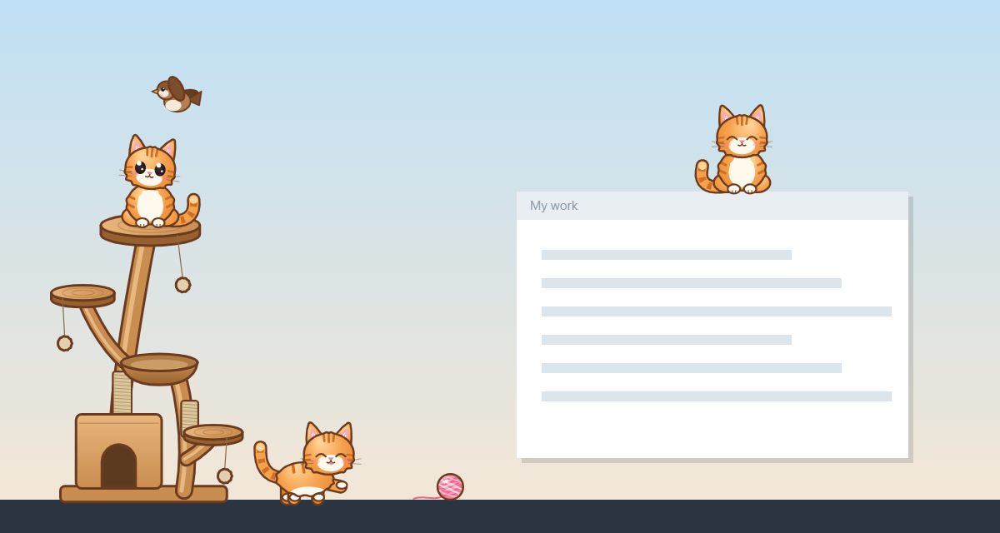

# Desktop Cat 🐾

A fluffy orange kitten that lives on your desktop while you work. It wanders
along the bottom of your screen, naps in the corners, climbs its own cat tree,
sits on top of your windows, chases sparrows, plays with a ball of yarn — and
you can pick it up, feed it, and even give it a bath.



> 🎬 *GIF of the kitten in action coming soon.* (Record one with a free tool such as
> [ScreenToGif](https://www.screentogif.com/) on Windows or the built-in screenshot
> tool on a Mac, save it as `docs/demo.gif`, and add `` here.)

Works on **Windows 10/11** and **macOS** (Apple silicon and Intel).

---

## What the kitten does

- 🚶 **Wanders** along the top of your taskbar / Dock, mostly hanging out in the corners.
- 😴 **Naps** after a few minutes on its own — with a floating "zzz". Hover over it to wake it.
- 🐾 **Sits, grooms, stretches and yawns** in between.
- 🖱️ **Chases your mouse pointer** now and then, and looks up at it.
- 🤚 **Pick it up** with the mouse and drop it — it falls, lands with a squish, and gets dizzy if you dropped it from very high.
- 💕 **Click it** for a happy hop and a heart or two.
- 🌳 **Climbs its cat tree** and sits on the platforms or naps in the bowl bed.
- 🐦 **Sparrows** sometimes visit while it's up high — it watches them, pounces… and misses.
- 🪟 **Jumps onto the window you're using** and rides along if you move the window.
- 🍲 **Play mode**: fill its food bowl, give it a fish treat, run it a bubble bath (with a rubber duck), or throw it a ball of yarn.
- 😼 **Mischief mode** (off unless you turn it on): it bats your resting mouse pointer a little.

It's lightweight (around 1 % CPU awake, less asleep) and clicks pass straight
through everything except the kitten and its toys, so it never gets in your way.

## Download and install

Go to the **[Releases page](../../releases/latest)** and download the file for your computer:

| Computer | File |
|---|---|
| Windows | `Desktop-Cat-Setup-x.y.z.exe` |
| Mac with Apple silicon (M1/M2/M3…) | `Desktop-Cat-x.y.z-mac-arm64.dmg` |
| Mac with Intel | `Desktop-Cat-x.y.z-mac-x64.dmg` |

### Windows: "Windows protected your PC"

The app isn't signed with a paid certificate, so Windows SmartScreen warns you the first time.

1. Double-click the installer. If you see **"Windows protected your PC"**, click **More info**.
2. Click **Run anyway**, then follow the installer.
3. The kitten appears at the bottom of your screen, and a little cat face appears by the clock
   (click the **^** arrow if you don't see it).

### Mac: "can't be opened because it is from an unidentified developer"

1. Open the `.dmg` and drag **Desktop Cat** into **Applications**.
2. Open it from Applications. macOS will refuse the first time — click **Done** / **OK**.
3. Open **System Settings → Privacy & Security**, scroll down, and click **Open Anyway** next to
   "Desktop Cat was blocked". Confirm with **Open**.
4. If macOS says the app **"is damaged and can't be opened"**, open **Terminal** and run:

   ```bash
   xattr -cr "/Applications/Desktop Cat.app"
   ```

   then open it again. (This removes the "downloaded from the internet" flag; the app is fine.)

The kitten's menu lives in the **menu bar** at the top of the screen (the little cat face).

## Using it

Click the cat face by the clock (Windows) / in the menu bar (Mac) — or **right-click the kitten** —
for the menu:

| Menu item | What it does |
|---|---|
| Hide cat / Show cat | Hides the kitten, its tree and toys (or brings them back) |
| Pause | The kitten sits still |
| Fill the food bowl · Give a treat (fish) · Bath time · Play with the yarn ball | Play mode! Drag the bowl, fish, tub or yarn wherever you like — throw the yarn |
| Put toys away | Removes the current toy |
| Cat tree | Shows / hides the cat tree (drag it to move it; it remembers where) |
| Cat size | Small, medium or large (the kitten restarts) |
| Walking speed | Slow, normal or fast |
| Mischief mode | The kitten sometimes bats your resting mouse pointer up to 40 pixels sideways. It **never clicks or types**, and stops the moment you move the mouse. |
| Launch at startup | Start Desktop Cat when you log in |
| Quit Desktop Cat | Bye-bye 👋 |

Your choices are remembered between launches.

**Mischief mode on a Mac** needs permission to move the pointer: **System Settings → Privacy &
Security → Accessibility**, then switch on **Desktop Cat**. Without it, mischief mode simply does
nothing. (Climbing onto windows doesn't need any permission.)

## Run it from the source code

You need [Node.js](https://nodejs.org/) (the "LTS" version).

```bash
git clone https://github.com/dileep-svg-hub/desktop-cat.git
cd desktop-cat
npm install
npm start
```

Quit with **Ctrl+C** in the terminal or **Quit Desktop Cat** in the menu.

> **Windows tips:** if PowerShell says *"running scripts is disabled"*, type `npm.cmd` instead of
> `npm` (or run `Set-ExecutionPolicy -Scope CurrentUser RemoteSigned` once). If `npm start` says
> Electron failed to install, run `node node_modules/electron/install.js`.

### Build the installers yourself

```bash
npm run build:win     # on Windows -> dist/Desktop-Cat-Setup-x.y.z.exe
npm run build:mac     # on a Mac   -> dist/*.dmg and dist/*.zip
```

You don't normally need to: publishing a **Release** on GitHub builds both automatically
(see [`.github/workflows/release.yml`](.github/workflows/release.yml)).

## Change how the cat looks

The kitten isn't a picture — it's drawn with code, so it stays sharp at any size.

- **Colours** — open [`src/renderer/kitten.js`](src/renderer/kitten.js) and edit the `COL` list at
  the top (e.g. make `fur` grey `#9a9a9a` and `stripe` dark grey `#6e6e6e` for a grey tabby).
  The toys, tree and sparrow are in [`src/renderer/props.js`](src/renderer/props.js).
- **Shapes and poses** — each pose (`walk`, `sit`, `sleep`, …) is a small function in `POSES`
  in `kitten.js`.
- **Icons** — after changing the look, run `npm run icons` to redraw the app and tray icons.
- **Sounds** — the kitten is silent by default. Put your own `meow.wav` and `purr.wav` in
  [`assets/sounds`](assets/sounds) to give it a voice (see the README there).

## How it works (for the curious)

Desktop Cat is an [Electron](https://www.electronjs.org/) app. The kitten, its tree, each toy and
the sparrow are tiny **transparent, always-on-top windows** that ignore the mouse except over their
own pixels. The *main process* ([`src/main/main.js`](src/main/main.js)) moves those windows around
(walking, falling with gravity, jumping, rolling) and talks to the operating system; the kitten's
*brain* ([`src/renderer/cat.js`](src/renderer/cat.js)) is a little state machine that decides what
to do next. [`get-windows`](https://github.com/sindresorhus/get-windows) finds the window to climb
on, and [`nut-js`](https://github.com/nut-tree/nut.js) moves the pointer in mischief mode.

## License

[MIT](LICENSE) — the simplest common open-source licence: anyone may use, change and share this
code for free, as long as they keep the copyright notice.
